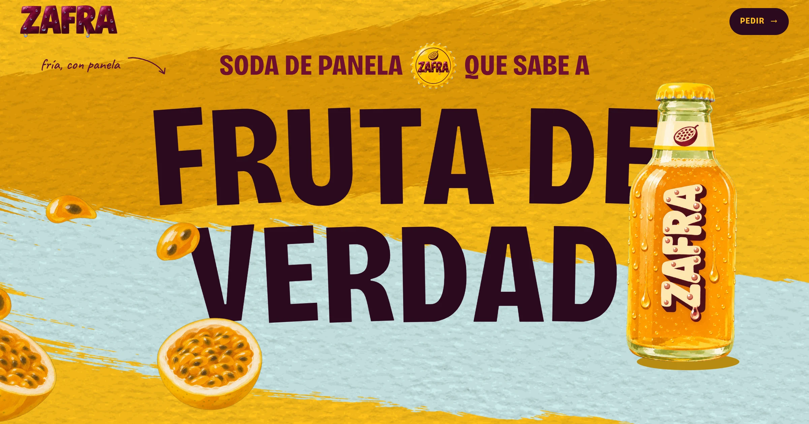
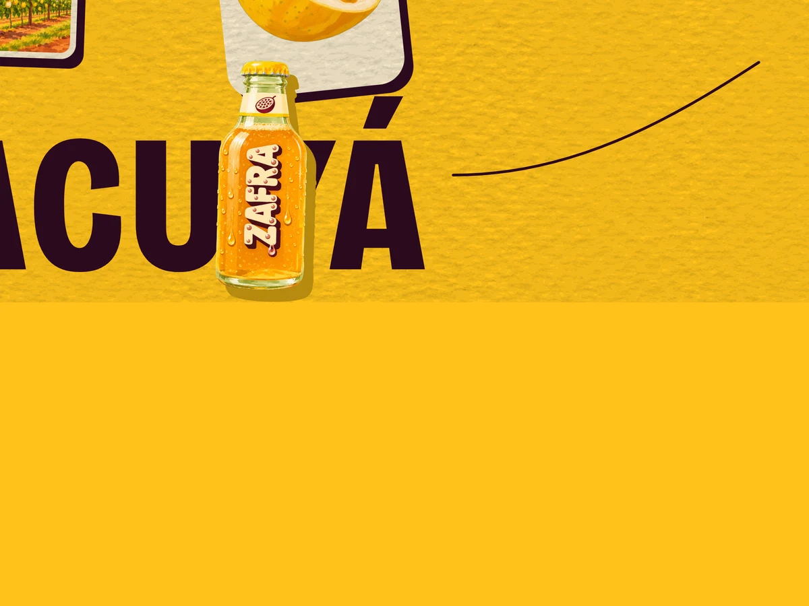
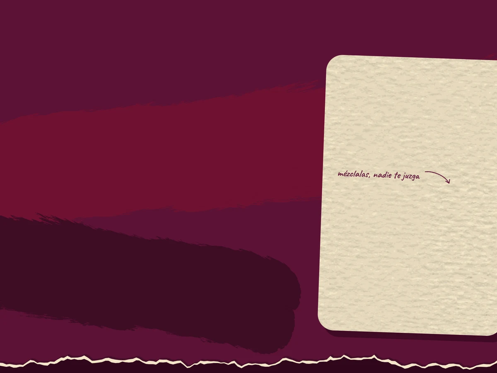

<div align="center">

# ZAFRA · A scroll-driven fruit soda landing

**One scroll timeline, one 2D gouache bottle.**
A concept site for a fictional Colombian panela soda (maracuyá, mora, lulo): horizontal hero→manifesto, paper tears, flavor zigzag, and a WhatsApp six-pack builder.

[**Visit the demo →**](https://jesusgabri3l.github.io/zafra/)

<br />



</div>

<table>
  <tr>
    <td align="center" width="33%"><br /><sub>A · Manifiesto</sub></td>
    <td align="center" width="33%"><br /><sub>C · Sabores</sub></td>
    <td align="center" width="33%"><br /><sub>D · Pedido</sub></td>
  </tr>
</table>

## Overview

ZAFRA is not a real brand: the WhatsApp number, prices and copy are made up. The point is the **scrollytelling mechanic** and the gouache art direction.

| Section | What happens |
|---|---|
| **Hero** | Intro by time (no loader): letters bounce in, bottle drops on the maracuyá, fruit splits. |
| **A Manifiesto** | Horizontal pass into a cream card; nail cap pins the recipe (pulp + panela + bubbles). |
| **B Fill** | “La más fría” with ice cubes that fall on scroll. |
| **C Sabores** | Zigzag MARACUYÁ → MORA → LULO, postals, one bottle changes flavor with a 2D spin. |
| **D Pedido** | Pick flavors, build a six-pack, open WhatsApp. |

## How it's built

**Astro 7** (static) · **GSAP** (single timeline = `scrollY`) · Lenis · Sass · TypeScript · GitHub Pages.

- **One paused timeline.** `story.ts` maps `window.scrollY` to `timeline.time()`. Sticky sections keep layout measurements honest; bottle poses never fight each other (`immediateRender: false` on every handoff).
- **2D bottle, not 3D.** Three gouache WebP frames (maracuyá, mora, lulo) with CSS transforms, contact shadow and flavor crossfade—no WebGL.
- **Paper world.** `BaseStroke` mask-paints brush strokes; `BaseTear` is a deterministic noisy edge; PNG sources are all exported to WebP under `public/`.
- **`BASE_PATH` safe.** CSS backgrounds use `--img-*` set in `BaseLayout`; Astro/TS use `import.meta.env.BASE_URL` so `/zafra/` on Pages works.
- **Accessible.** Skip link, `aria-labelledby` sections, live region on the order form, `prefers-reduced-motion` stacks sections without the scroll film.

## Development

Node 22+ (24 in CI). Requires `npm install`.

```sh
npm run dev       # http://localhost:4321
npm run build     # ./dist/
npm run start     # production build on :3100 (for Lighthouse)
```

Asset scripts (need local `fuentes/`, gitignored): `node scripts/export-fruit.mjs`, `node fuentes/exportar_botellas.mjs`. **Capturas / OG:** `npm run build && npm run og && npm run build` → `public/og.jpg` + `docs/screenshots/*-v2.webp`.

## Structure

```
src/
  views/HomeView.astro    # all sections + bottle stack
  scripts/story.ts        # scroll timeline
  scripts/bottle/         # 2D bottle stack
  components/home|base|layout/
  data/flavors.ts
public/img|bottle/
```

Design and animation notes live in `design-brief.md` (local, not in the public repo).

## Analytics

[GoatCounter](https://www.goatcounter.com) on the published build only (no cookies). Events:

| Event | When |
|---|---|
| `scroll-hero` … `scroll-footer` | Each main section crosses ~35% visibility once |
| `click-github` / `click-portfolio` | Footer credits (text + icon) |
| `click-linkedin` | LinkedIn icon and column link |

## Credits

Design & development: [Jesús Gabriel](https://jesusgabriel.dev/) · Illustrations: AI-assisted gouache workflow (see repo prompts file).