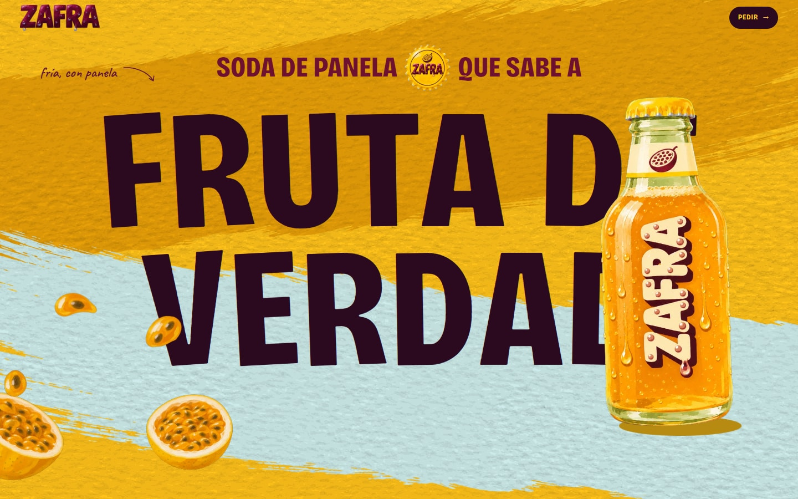
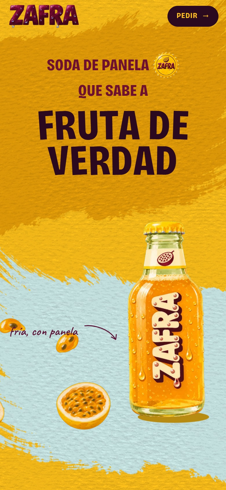
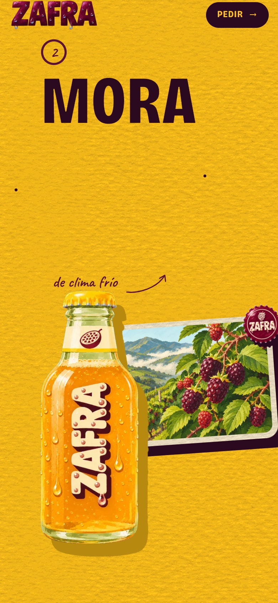
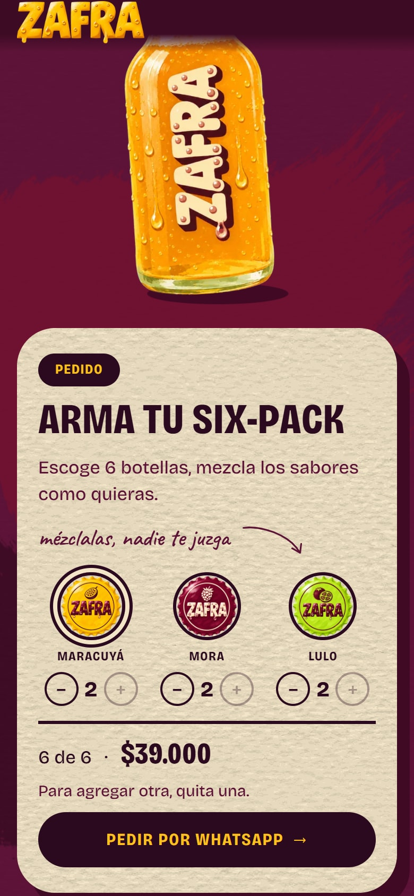
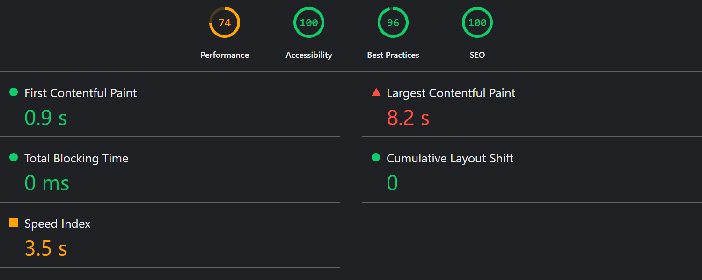
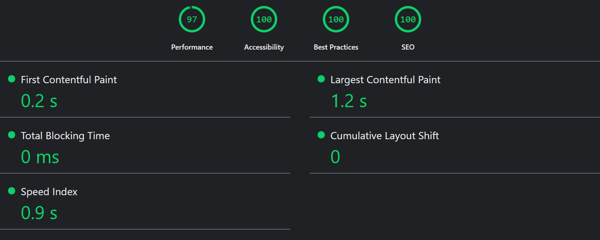

<div align="center">

# ZAFRA · A landing page for a fruit soda brand

**One scroll timeline, one 2D bottle.**
A concept site for a fictional Colombian panela soda (maracuyá, mora, lulo): horizontal hero→manifesto, paper tears, a flavor zigzag, and a WhatsApp six-pack builder.

[**Visit the demo →**](https://jesusgabri3l.github.io/zafra/)

<br />



</div>

## Overview

A landing page concept for a fictional brand. ZAFRA is not a real business: the name, flavors, prices and WhatsApp number are made up.

<table>
  <tr>
    <td align="center" width="33%"><br /><sub>Hero</sub></td>
    <td align="center" width="33%"><br /><sub>Sabores</sub></td>
    <td align="center" width="33%"><br /><sub>Pedido</sub></td>
  </tr>
</table>

- **Hero:** intro by time (no loader): letters bounce in, the bottle lands on the maracuyá, the fruit splits.
- **A Manifiesto:** horizontal pass into a cream card; the nail cap pins the recipe (pulp + panela + bubbles).
- **B Fill:** “La más fría” with ice cubes that fall on scroll.
- **C Sabores:** zigzag MARACUYÁ → MORA → LULO, postals, one bottle that changes flavor with a 2D spin.
- **D Pedido:** pick flavors, build a six-pack, open WhatsApp with the message filled in.

## How it's built

**Astro 7** (static) · **GSAP** (one timeline = `scrollY`) · Lenis · Sass · TypeScript · GitHub Pages.

- **One paused timeline.** `story.ts` maps `window.scrollY` to `timeline.time()`. Sticky sections keep measurements honest; bottle poses do not fight (`immediateRender: false` on every handoff).
- **2D bottle, not 3D.** Three gouache WebPs (maracuyá, mora, lulo) with CSS transforms, a contact shadow and flavor crossfade—no WebGL.
- **Paper world.** `BaseStroke` paints brush strokes with a mask; `BaseTear` is a deterministic noisy edge. All art ships as WebP under `public/`.
- **Accessible.** Skip link, `aria-labelledby` sections, live region on the order form, and with *reduce motion* the page stacks sections without the scroll film.

## PageSpeed

PageSpeed Insights on the [live demo](https://jesusgabri3l.github.io/zafra/), November 24, 2026:

<table>
  <tr>
    <th width="50%">Mobile</th>
    <th width="50%">Desktop</th>
  </tr>
  <tr>
    <td></td>
    <td></td>
  </tr>
</table>

| PageSpeed | Mobile | Desktop |
|---|---|---|
| First Contentful Paint | 0.9 s | 0.2 s |
| Largest Contentful Paint | 8.2 s | 1.2 s |
| Cumulative Layout Shift | 0 | 0 |
| Total Blocking Time | 0 ms | 0 ms |

## Development

Requires Node 22 or later (24 in CI).

```sh
npm install
npm run dev       # local server at http://localhost:4321
npm run build     # builds the site into ./dist/
npm run preview   # serves the build locally
```

## Author

Jesús Ahumada — [Portfolio](https://jesusgabriel.dev/) · [LinkedIn](https://www.linkedin.com/in/jesus-ahumada) · [GitHub](https://github.com/jesusgabri3l)